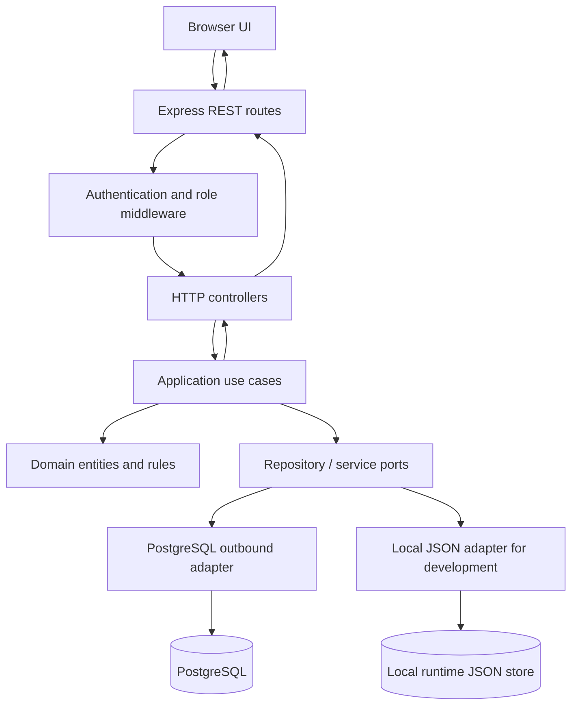

# Project Architecture — FaCICuSe

## 1. System overview

FaCICuSe coordinates CICS facility discovery, availability review, reservations, class schedules, maintenance reporting, and administrator operations. The application is served by Node.js/Express, uses a web frontend, and persists operational data through PostgreSQL in production.

## 2. Architecture style

The backend uses **Hexagonal Architecture (Ports and Adapters)**:

- **Domain core — `server/domain/`:** entities, value objects, business rules, facility and schedule policies, and domain errors. This layer owns rules such as reservation conflict validation and canonical facility resolution.
- **Application core — `server/application/`:** use cases that orchestrate workflows without binding business policy to Express or a particular database. Port contracts are declared in `server/application/ports.js`.
- **Inbound adapters — `server/adapters/inbound/`:** Express routes, HTTP controllers, authentication middleware, role checks, request limiting, and error serialization.
- **Outbound adapters — `server/adapters/outbound/`:** repository implementations, Firebase Auth integration, password hashing, and persistence-specific code.
- **Infrastructure — `server/infrastructure/`:** environment configuration and the composition root that wires ports, adapters, use cases, and controllers.

The composition root in `server/infrastructure/container.js` constructs the adapters, validates their required port methods, creates use cases, and exposes the API router.

## 3. Backend request/data flow

For production, the runtime configuration requires a configured PostgreSQL connection and does not permit falling back to the local JSON store. The local store is intended for non-production development.

## 4. Frontend and API boundary

- `client/` contains the authenticated React/Vite workspace, reusable components, page views, contexts, API/Firebase client services, and utility modules.
- `client/public/index.html` is the separate public landing page source. Its stylesheets and vanilla JavaScript interactions live under `client/public/assets/css/` and `client/public/assets/js/`.
- The frontend communicates with Express through the `/api` routes; frontend route visibility is not the authorization boundary.
- The production Express server serves the standalone landing page at `/`, generated client assets, and the authenticated SPA for application routes.

The current frontend is intentionally preserved during this organization pass. The authenticated workspace remains React/Vite; this change does not claim to have migrated the entire application to a Vanilla-JavaScript-only SPA.

## 5. Outbound persistence organization

PostgreSQL-specific implementation is grouped under `server/adapters/outbound/postgres/`:

- `index.ts` — PostgreSQL connection pool, Drizzle instance, and connection verification.
- `schema.ts` — Drizzle table and relation definitions.
- `repositories.js` — repository adapter implementation.

`server/adapters/outbound/seedService.js` coordinates the canonical facility catalog and approved initial schedule data using the PostgreSQL adapter. It is part of application startup behavior; do not run it against production during a cleanup or test.

Drizzle Kit configuration is at the repository root in `drizzle.config.ts`; versioned SQL migrations remain in `drizzle/`. Moving source files does not change table names, migration contents, IDs, relationships, or database records.

## 6. Authentication and authorization

- Firebase Authentication is integrated through the outbound Firebase Auth adapter.
- Express session middleware validates the server-issued session and resolves the user from the application repository.
- The API routes use server-side middleware for protected operations.
- Administrator routes, including `GET /api/admin/analytics` and `GET /api/admin/analytics/export.csv`, require authentication and the System Administrator role.
- Public pages may read public facility and timetable data, but public visibility does not grant write permissions.

## 7. Main operational data

The Drizzle schema defines:

| Entity/table | Responsibility |
|---|---|
| `users` | User identity, role, account state, and authentication metadata |
| `facilities` | Canonical CICS facility inventory and facility settings |
| `reservations` | Time-bounded facility reservation requests and review status |
| `class_schedules` | Recurring class schedule blocks and verification metadata |
| `maintenance_issues` | Reported facility maintenance items and their status |
| `notifications` | User-scoped notifications |
| `audit_logs` | Administrative and operational audit events |

The inventory catalog is maintained in the domain project information and synchronized by the existing server startup catalog service. Production data integrity must be checked through read-only review or an isolated test database; this documentation change does not seed or alter production data.

## 8. Build/runtime assets

- Vite builds the authenticated SPA from root `index.html`.
- `scripts/copy-public-assets.mjs` copies the standalone landing page and its static assets into `dist/`.
- Express serves `dist/landing.html` at the public root and serves the SPA for application routes.
- Render runs `bun install --frozen-lockfile && bun run build`, then `bun run start` on the existing standalone service.

## 9. WST/SIA mapping

| Course area | Implemented location |
|---|---|
| HTML page structure | `client/public/index.html`, Vite root `index.html`, JSX page/components |
| CSS presentation and responsiveness | `client/public/assets/css/`, `client/styles/`, component styles |
| JavaScript interactions/API use | `client/public/assets/js/`, JSX JavaScript, `client/services/api.js` |
| Node.js / Express backend | `server.ts`, `server/index.js`, `server/adapters/inbound/` |
| REST endpoints | `server/adapters/inbound/routes.js` |
| Domain/application separation | `server/domain/`, `server/application/` |
| Ports and adapters | `server/application/ports.js`, `server/adapters/` |
| Integration/composition | `server/infrastructure/container.js` |
| Database schema and migrations | `server/adapters/outbound/postgres/`, `drizzle/`, `drizzle.config.ts` |
| Verification | `server/**/*.test.js`, `.github/workflows/ci.yml`, `docs/QUALITY-ASSURANCE-CHECKLIST.md` |

The official IT 314 guideline allows HTML, CSS, JavaScript/TypeScript, and appropriate web technologies. A stricter group master prompt also called for a Vanilla-JavaScript-only frontend; the current authenticated SPA is React/Vite. Do not misrepresent this as Vanilla-JavaScript-only. Confirm the expected interpretation with the instructor before undertaking a full frontend migration.

## 10. Change-safety rules

1. Keep domain and application use cases independent of Express, React, Drizzle, and Firebase SDK imports.
2. Keep PostgreSQL connection/schema/repository code within the outbound adapter.
3. Keep migrations versioned; never edit or apply production migrations as part of cosmetic cleanup.
4. Keep API role authorization on the server.
5. Do not interpret a reservation as evidence of physical room occupancy.
6. Do not add fabricated dashboard data or facility inventory.
7. Preserve the approved floor-organized facility photographs and exact canonical logo asset.
