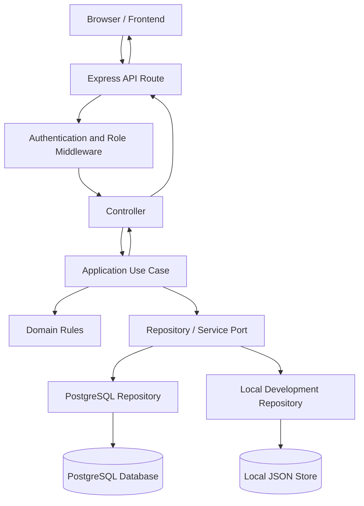

# Project Architecture — FaCICuSe

## 1. System overview

FaCICuSe has a browser frontend, a Node.js/Express backend, an application core, database repositories, Firebase authentication integration, and a PostgreSQL database.

The source folders are named by responsibility so the code can be located quickly:

- `frontend/` — Website pages, reusable interface components, browser services, styles, and public assets.
- `backend/` — Express API, business rules, workflows, authentication, and database access.
- `drizzle/` — Versioned database migrations.
- `docs/` — Project and technical documentation.

## 2. Backend design

The backend retains **Hexagonal Architecture (Ports and Adapters)**. Renaming the folders to familiar project terms does not remove the separation between business logic and technology-specific code.

| Layer | Folder | Responsibility |
|---|---|---|
| Domain | `backend/domain/` | Core entities, value objects, validation, facility policies, and business rules |
| Application | `backend/application/` | Use cases and port contracts that coordinate business workflows |
| HTTP routes | `backend/routes/` | Express API paths and route-to-controller mapping |
| Controllers | `backend/controllers/` | Convert HTTP requests into use-case calls and format responses |
| Middleware | `backend/middleware/` | Authentication, role checks, request limiting, and error handling |
| Database | `backend/database/` | PostgreSQL and local repository implementations |
| Services | `backend/services/` | Firebase Admin authentication integration |
| Utilities | `backend/utils/` | Password hashing and verification |
| Configuration | `backend/config/` | Environment-variable validation and runtime settings |
| Bootstrap | `backend/bootstrap/` | Composition root that connects ports, adapters, use cases, and HTTP handlers |

Port contracts are defined in `backend/application/ports.js`. The PostgreSQL and local repository implementations satisfy the data ports; the Firebase service provides the external identity integration. The composition root in `backend/bootstrap/applicationContainer.js` wires these dependencies together.

## 3. Request and data flow

Production uses PostgreSQL. The local JSON repository is for non-production development only. Production startup does not allow an unconfigured local-storage fallback.

## 4. Frontend and backend connection

- `frontend/main.jsx` starts the React application.
- `frontend/App.jsx` defines the application page routes.
- Frontend pages call the API using `frontend/services/api.js`.
- The backend mounts the API at `/api`.
- The public landing page source is `frontend/public/index.html`; its CSS and vanilla JavaScript are in `frontend/public/assets/css/` and `frontend/public/assets/js/`.
- The Express application serves the public landing page at `/` and the authenticated application on its app routes.

The root `index.html` is the Vite entry page for the authenticated React application. The root `server.ts` starts the Express application in `backend/index.js`.

## 5. Database organization

PostgreSQL-specific code is grouped in `backend/database/postgres/`:

- `connection.ts` — PostgreSQL connection pool, Drizzle instance, and connection verification.
- `schema.ts` — Drizzle table and relation definitions.
- `repositories.js` — Database repository implementations.
- `repositories.integration.test.js` — PostgreSQL repository integration test.

`backend/database/facilityCatalogService.js` contains the existing catalogue and initial class-schedule synchronization logic. `drizzle.config.ts` points Drizzle Kit to the schema, and versioned SQL migrations remain in `drizzle/`.

Moving these source files does not change table names, migrations, IDs, relationships, or production records.

## 6. Main data and feature locations

| Feature | Frontend | Backend |
|---|---|---|
| Public homepage | `frontend/public/index.html` and `frontend/public/assets/` | `backend/index.js` serves the page and static assets |
| Facility directory | `frontend/pages/FacilitiesDirectoryPage.jsx` | `backend/application/useCases/facilityUseCases.js`, domain rules, and database repositories |
| Facility details | `frontend/pages/FacilityDetailPage.jsx` | Facility use cases and repository |
| Reservations | `frontend/pages/ReservationsPage.jsx` | `backend/application/useCases/reservationUseCases.js` |
| Class timetable | `frontend/pages/PublicTimetablePage.jsx` | `backend/application/useCases/classScheduleUseCases.js` |
| Maintenance reports | `frontend/pages/IssuesPage.jsx` | `backend/application/useCases/maintenanceUseCases.js` |
| Admin analytics | `frontend/pages/AdminAnalyticsPage.jsx` | `backend/application/useCases/analyticsUseCases.js` |
| Sign in | `frontend/context/AuthContext.jsx`, `frontend/services/firebase.js` | `backend/services/firebaseAuthService.js`, `backend/middleware/authMiddleware.js`, and user use cases |

## 7. Authentication and permissions

Firebase Authentication is integrated through `backend/services/firebaseAuthService.js`. The backend validates credentials/session tokens, resolves the user, and applies role authorization in `backend/middleware/authMiddleware.js`.

Administrator routes are protected server-side. The frontend only controls what navigation and pages are shown; the API is the security boundary. Admin analytics and account-management endpoints require the System Administrator role.

## 8. Build and runtime

- Vite builds the authenticated frontend from the root `index.html`.
- `scripts/copy-homepage-assets.mjs` copies the standalone public homepage and its static assets into `dist/`.
- `backend/index.js` serves `dist/landing.html` at the public root and the authenticated SPA on application routes.
- Render uses `bun install --frozen-lockfile && bun run build` and `bun run start`.

## 9. Change-safety rules

1. Keep domain and application rules independent of Express, React, Firebase SDK details, and Drizzle implementation details.
2. Keep HTTP routes, controllers, and middleware in their clearly named folders.
3. Keep database access in `backend/database/`; use the repository ports from the application core.
4. Keep migrations versioned and review them separately from code organization.
5. Keep administrator access enforced in the backend.
6. Do not treat a reservation as proof of physical occupancy.
7. Do not seed or alter production data during a source-only cleanup.
